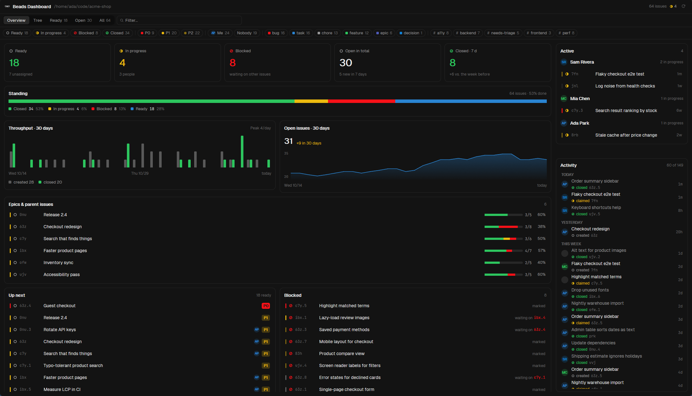

# Beads Dashboard

A [Herdr](https://herdr.dev) mod for the [beads](https://github.com/steveyegge/beads)
issue tracker: a docked issue tree and list for the repo of the focused terminal,
and a full-tab dashboard. English or German (follows the system).



## Install

Copy `mods/beads-dashboard/` to `~/.config/herdr-app/mods/` (or ask your Herdr
agent to add `github.com/<owner>/herdr-beads-dashboard`). `bd` must be installed
on each machine whose repos you open (Windows and WSL count separately).

Optional keys (`keys.json`), e.g.:

```json
{ "mod:beads-dashboard": { "ctrl-r": "beads-dashboard.refresh" } }
```

Commands: `focus`, `refresh`, `wide`, `view:overview|tree|ready|open|all`,
`filter:<text>`, `show:<id>`, `quick:<chip>`, `next`, `prev`, `fold`, `start`, `close`, `reopen`,
`copy`, `insert`, `lang:de|en|auto`.

See [RECIPE.md](RECIPE.md) for the full description.

## License

MIT, see [LICENSE](LICENSE).
