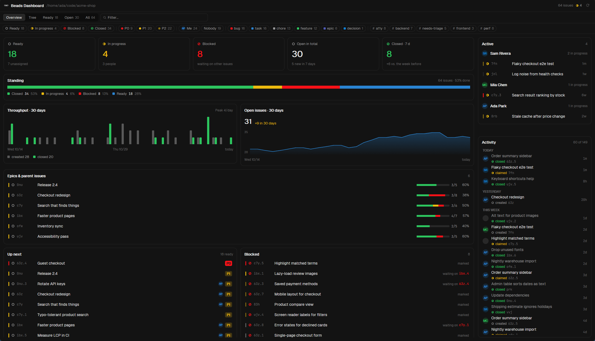

# Beads Dashboard

A panel for the [beads](https://github.com/steveyegge/beads) issue tracker (`bd`)
of whatever repo the focused terminal is in. Docked at the side it is a compact
issue tree and list with quick filters and the issue opening under its row; one
click opens it as a full tab with a dashboard (counts, a standing bar, 30-day
charts, epics, what's ready, what's blocked, who's active, recent activity), a
sortable and groupable list and a detail pane. It can start, close, reopen,
copy and paste issue ids into the terminal. English, or German when the system
is German. Works on Windows, WSL and other remote machines, Linux and macOS.

## What you see

All colors are theme tokens (`t.background`, `t.surface`, `t.border`,
`t.accent`, `t.working`, `t.ansi1`–`t.ansi6`, …), so it follows the theme.

**Frame:** one rounded (10px) box, 1px `t.border`, `t.background`, 13px text.

**Header (42px):** the beads icon (15px, `t.muted`), the title "Beads"
(docked) or "Beads Dashboard" (tab), the repo folder name (docked) or its full
path (tab) in 12px `t.dim`; in the tab, "N issues"; a count of issues in
progress (status glyph + number); a spinning spinner while bd runs, else a reload button; docked, a
"⤢" button that opens the tab.

**View bar (38px):** segmented views in a `t.chrome` pill: **Overview** (tab
only), **Tree**, **Ready**, **Open**, **All**; in the tab each list view shows
its count. Next to it a filter field (26px, search icon, "Filter…"; at most
360px wide in the tab, accent border while typing). Docked, the field ends in a
filter icon that shows or hides the quick filters, with the number of chips on.

**Quick filters:** rows of 22px pill chips (rounded 11, count on each, accent
border when on), in groups **Status** (Ready, In progress, Blocked, Deferred,
Closed), **Priority** (P0–P2), **Person** (Me, Nobody), **Type** (the types in
the data) and **Label** (the most common labels of open issues: 8 in the tab, 6
docked), plus "× reset" while any is on.

**Status glyphs** (12px SVGs `st-*.svg`): open `t.muted`, in progress
`t.working`, blocked `t.ansi1`, closed `t.ansi2`, deferred `t.dim`.
**Priority badges** (24×17): P0 filled `t.ansi1`, P1 `t.ansi3` tint, P2
`t.ansi4` tint, P3 `t.raised`, lower outlined. **Type**: a colored letter or pill —
bug B `ansi1`, feature F `ansi2`, task T `ansi4`, epic E `ansi5`, chore C
`muted`, decision D `ansi6`. **Avatars**: initials in a circle colored by a
hash of the name (`ansi4/5/6/2/3`).

**Docked (narrow) views:**
- *Tree*: a 32px toolbar ("12 open · 40 closed", unfold all, fold all, show
  closed one by one) above 28px rows: indent guides (16px per level, the
  selected issue's parent line brighter), a fold chevron, status, short id,
  title (medium weight for parents), a small sub-issue progress bar and the
  priority badge. Closed children fold into one "23 closed" pill per parent.
- *Ready / Open / All*: 30px rows with priority badge, type letter, the id
  without the prefix all ids share, the title and the status.
- Clicking a row opens its detail right under it (markdown, up to 260px high,
  3000 characters), with the actions.

**Tab (wide):**
- *Overview*: five clickable KPI cards (Ready, In progress, Blocked, Open in
  total, Closed · 7 d, each with a 28px number and a line under it); **Standing**,
  one 10px bar split by state with a legend and percentages; **Throughput · 30
  days** (paired bars per day: created `t.muted`, closed `t.ansi2`) next to
  **Open issues · 30 days** (an area chart in `t.accent`); **Epics & parent
  issues** (up to 12, with progress and %); **Up next** and **Blocked** (8 each;
  blocked rows say what they wait on); **Open by …** (bars by priority, type,
  label). On the right, 380px wide: **Active** (people with their in-progress
  issues, at most 320px high) and **Activity** (the last 60 created, claimed
  and closed events, grouped Today, Yesterday, This week, Earlier; 38px rows
  with avatar, title, kind, id and age). Below 1180px it is one column; below
  980px the paired cards stack.
- *Tree* and *lists*: the same rows at 30px with columns TYPE, PROGRESS, P,
  ASSIGNEE, CHANGED (type shows above 640px, changed above 760px, assignee
  above 880px, two label chips above 1000px). The lists have a 36px toolbar
  ("52 issues · 4 groups", fold/unfold all groups, **Group by**: None, Status,
  Priority, Person, Type, Parent) and a sortable 28px header. Group headers
  are 30px `t.surface` bars with a chevron, icon, name, count and a progress
  bar. A draggable divider splits the list from the detail pane (480px,
  320–1100).
- *Detail pane*: parents as breadcrumbs; status, id, type and priority with
  copy and terminal buttons; the title at 18px semibold; a meta grid (status,
  assignee, labels, created, started, changed, closed, reason, external ref);
  the action buttons; sub-issues with a progress bar (up to 60); Description,
  Acceptance criteria, Design, Notes as markdown; dependencies as links. With
  nothing selected: "No issue selected" and the keys.

**Empty states:** "No folder", "Looking for the repo…", "Not a git repo", "No
beads in <repo>" ("No .beads folder found (bd init creates one)."), "bd not
found" ("Install beads (github.com/steveyegge/beads) on this machine, then
reload."), "bd error", "Loading beads…".

## How it behaves

- **Which repo:** the focused pane's folder and machine, like the shipped
  Files and Changes panels. From there it walks up to the nearest folder whose
  `.beads/` has `metadata.json` or `config.yaml`, stopping at the git root; a
  git worktree without its own falls back to the main checkout's. Focusing a
  non-terminal pane keeps the last repo of that space.
- **Refresh:** a view older than 10 s reloads every 2.5 s check, but only while
  the panel (or its tab) is on screen. After a bd error it waits 60 s. Reload
  button forces it. Only one bd call runs at a time.
- **Rows:** a click selects and opens the detail; hovering a tree row or a
  docked list row shows play (start), copy and terminal buttons. ↑ ↓ move the selection, ← → fold and
  unfold in the tree, Esc closes the detail (or clears the filter while typing).
- **Actions:** Start sets the issue in progress; Close asks "Really close?" and
  closes on the second click; Reopen reopens. Copy ID copies it; the terminal
  button pastes the id into the focused (or last used) terminal. A note shows
  in a footer for 6 s (red for errors); clicking it hides it.
- **Filter:** text matches id, title, labels, assignee and type (any case); quick chips combine
  with OR inside a group and AND across groups. The tree and the docked
  lists draw 400 rows, then "Show N more" (+400); the tab's lists are virtual
  and draw only what is on screen.
- **Dashboard:** every KPI card, standing legend entry, bar and "… more" link
  jumps to the matching list with one chip on; mini rows open the issue in the
  tree (parents unfolded); resting on a mini row 550 ms shows a hover card
  (status, id, type, priority, assignee, age, progress, the start of the
  description, labels). Day bars and chart columns have tooltips.
- **List header:** click a column to sort, again to reverse, a third time back
  to the usual order (open before closed, by priority, then state, then last
  change; closed newest first). Clicking a group header folds it; Closed starts
  folded.
- **Remembered** (per copy, in `localStorage`): view, grouping, sort, quick
  chips, quick bar open, closed shown, language.
- **Language:** German if the system locale starts with `de` (Windows
  registry, `defaults read -g AppleLocale` on macOS, `LC_ALL`/`LC_MESSAGES`/
  `LANG` elsewhere), else English.

## Built from

- `mods/beads-dashboard/main.js` (one `View` class, ~2060 lines), `mod.json`
  `{ "place": "right", "size": 380, "title": "Beads Dashboard" }`, and 17 SVGs:
  `beads`, `chev-down`, `chev-right`, `copy`, `filter`, `fold`, `play`,
  `refresh`, `search`, `spinner`, `st-open`, `st-progress`, `st-blocked`,
  `st-closed`, `st-deferred`, `terminal`, `unfold`.
- `herdr`: `spaces`, `panes`, `focused`, `layout` (where it is, whether it is
  shown), `exec` (with `{cwd, on}` for the pane's machine), `readTextFile`,
  `home`, `theme`, `settings` (mono font), `props`, `nextCommand`, `run`
  (`tab.new`, `pane.focus`, `terminal.paste`).
- `gpui-base`: `v_flex`, `h_flex`, `Input`/`InputState`, `TextView.markdown`,
  `ScrollHandle`, `v_virtual_list` + `VirtualListScrollHandle` + `Scrollbar`,
  `h_resizable`/`resizable_panel`, `HoverCard`, `ToggleGroup`/`Toggle`,
  `Progress`/`ProgressTrack`/`ProgressIndicator`; `gpui-kit`: `div`, `svg`,
  `PathBuilder`, `Background.linear_gradient`, `window.paint_path`.
- **Props** (the tab copy): `{ wide: true, cwd, on }` and optional
  `lang: "de" | "en"`. The ⤢ button opens it with
  `run("tab.new", { name: "Beads · <repo>", mod: "beads-dashboard", props })`.
- **Programs it runs**, on the pane's machine: `bd` (found on `PATH`, in the
  usual install folders or via a login shell; on Windows also `where bd` and
  `%USERPROFILE%\go\bin`, `.local\bin`, `AppData\Local\Programs\bd`,
  `scoop\shims`), `sh` and `git` (finding the repo; on Windows `git` plus
  `readTextFile`), `reg` / `defaults` / `sh` once for the language.
  bd calls: `bd ready --json -n 0`, `bd list --json --flat -n 0`,
  `bd list --all --json --flat -n 0` and `bd show <id> --json` for the detail
  (all with `--readonly`), and `bd update <id> --status in_progress`, `bd close
  <id>`, `bd reopen <id>` (with `--json`).
- **Commands** (`keys.json` → `"beads-dashboard.<command>"`): `focus`,
  `refresh`, `wide`, `view:overview|tree|ready|open|all`, `filter:<text>`,
  `show:<id>`, `quick:<chip>`, `next`, `prev`, `fold`, `start`, `close`,
  `reopen`, `copy`, `insert`, `lang:de|en|auto`.
- "Me" is `git config user.name` in that repo, matched to assignees after
  lowercasing and dropping everything but letters and digits.

## Watch out

- A render has a time budget. Everything derived from the data (tree, list
  rows, dashboard numbers) is cached per data + filter + sort + group + day;
  descriptions are cut to 400 characters before any regex (some are 100 KB);
  the rich hover card is built only for the row under the pointer. A first
  render of a big repo in a background tab can still show "interrupted" until
  the tab is shown; it then renders normally.
- Two-line activity rows need 38px; at 30px the lines overlap.
- `hover` styling inside virtual-list rows is wrapped in a fallback that drops
  it if the runtime refuses it.
- "Ready" in the Ready view is what `bd ready` says; elsewhere an open issue is
  blocked when a `blocks` dependency points at an issue that is not closed.
- bd must be installed on every machine the panel looks at (Windows and WSL
  separately). It writes only through Start/Close/Reopen.
- The ids drop the prefix all ids share; the full id is in the tooltip and the
  detail.
- `place: "right"` docks it once on first sight; after that the layout decides.

## Done when

- In a terminal inside a repo with `.beads/`, the docked panel shows the repo
  name and its issues as a tree; a subfolder resolves to the same repo.
- Outside a repo it says "Not a git repo"; in a repo without `.beads` it says
  "No beads in <repo>"; without bd it says "bd not found" with the install hint.
- ⤢ opens a tab "Beads · <repo>" with the Overview; "Open in total" equals the
  number of issues in `bd list --json --flat -n 0`, and each KPI click lands
  on the list with that one status chip on.
- The tab list sorts on header click (▲, ▼, back), groups by each option and
  folds groups; the detail pane is resizable.
- Start, Close (two clicks) and Reopen change the issue in `bd show <id>`, and
  the panel shows it within one refresh.
- The terminal button pastes the id at the prompt of the last terminal.
- With a German system locale the views read "Baum", "Offen", "Alle"; with
  `beads-dashboard.lang:en` bound and pressed they read English.
